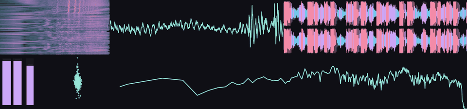

# taffymeters

[](https://github.com/taffy-nya/taffymeters/actions/workflows/ci.yml)
[](https://github.com/taffy-nya/taffymeters/releases/latest)

A lightweight, customizable real-time audio visualizer for Windows, inspired by MiniMeters.



## Features

- Visualize system audio or microphone input
- Spectrum, Spectrogram, Oscilloscope, Waveform, Stereometer, Level Meter and Loudness Meter
- Split windows into panels, open as many windows as you like, move panels between them
- Windows snap to each other and to screen edges, move as a group, stay on top or lock in place
- Per-panel settings and colors, dark and light themes
- Save your setup as a preset, or start with a built-in one
- Easy on the CPU: computes only what's needed and shares identical analyses between panels

## Download

Download the zip from [Releases](https://github.com/taffy-nya/taffymeters/releases), unzip and run `taffymeters.exe`.
Requires 64-bit Windows 10 or 11 with a Direct3D 12 capable GPU.

## Usage

| | |
|---|---|
| Split a panel | Hover its right or bottom edge and click `+` |
| Resize panels | Drag the divider; hold Alt for free positioning, double-click to even out |
| Move / resize a window | Drag inside it / drag its edge; hold Alt to stop snapping |
| Adjust a panel's range | Mouse wheel or Ctrl + wheel over it |
| Settings | Right-click; while open, click a panel to edit it |
| Pause | `Space` |
| Cancel a drag or move | `Esc` |
| Close a window | `Ctrl+W`; closing the last one quits |
| Locked window | Responds to right-click only; unlock in Settings › Window |

## Settings and files

Settings are kept in `%APPDATA%\taffymeters`; use `--config-dir <dir>` to keep them elsewhere, e.g. next to a portable copy.
To start over, load the Default preset in Settings › Workspace, or delete the folder while the app is closed.

## Building

Requires Rust 1.92+ (`x86_64-pc-windows-msvc` toolchain) and Visual Studio Build Tools (MSVC and the Windows SDK).

```text
cargo build --release
```

See the [development guide](docs/development.md) and the [architecture overview](docs/architecture.md).

## Known limitations

- Doesn't follow changes of the system default audio device; pick the new device in Settings › Workspace.
- Multi-monitor setups with mixed display scaling are untested.

## License

GPL-3.0-or-later. Release packages include third-party licenses in `THIRD_PARTY_LICENSES.txt`.
