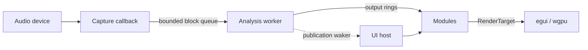

# Architecture

taffymeters is a single binary crate. Audio flows one way, from the capture callback through an analysis worker to the panels; the UI never waits on audio and the audio callback never waits on anything.



## Threads

| Thread | Does | Must not |
|---|---|---|
| Capture callback (cpal, WASAPI) | Copies interleaved samples into preallocated blocks and queues them | Allocate, lock, or block; a full queue drops the newest block and records the gap |
| Analysis worker | Runs the node graph for every block, pushes results into output rings, wakes the UI | Touch UI state |
| UI | One invisible host window renders every workspace window as an egui immediate viewport; reads the latest results and draws | Run analysis |

The worker wakes the UI at most once per block and only when it published something. The UI paces those wakes to the frame rate limit (`workspace/pacing.rs`), so with no new audio nothing redraws.

## Workspace

```text
Workspace
└── Window (native window, position, always on top, lock, group)
    └── Layout (binary split tree)
        └── Leaf → Module instance
```

- Every change to the workspace goes through `WorkspaceAction` (`workspace/mod.rs`); the UI only records actions.
- Snapping, group moves and edge resizing are done on native window messages (`workspace/native.rs`, Win32 subclassing), in physical pixels.
- The settings window is a separate viewport that edits the selected module, window or workspace.

## Modules and analysis

- A module type is a `ModuleFactory` registered in the `Registry` (`extensions.rs`). An instance declares what analysis it needs as a `DataSpec`, has view settings described by descriptors, and draws through `RenderTarget` (`render.rs`).
- A `DataSpec` is a small graph of nodes: `Channel`, `Fft`, `Tilt`, `Smooth`, `Gain`, `Peak`, `Levels`, `Loudness`. Each output keeps either its latest result or the last few seconds (history).
- The worker merges every subscription into one graph (`dataflow/engine.rs`). Stateless nodes with identical parameters are shared, so two panels showing the same FFT compute it once; stateful nodes (smoothing, peak hold) belong to their panel unless explicitly shared.
- Nodes with no subscriber don't run. Changing a panel's settings forks only the nodes that differ.

## Persistence

- `session.json` in the config directory is saved automatically and restored at startup; presets are separate files saved on request (`persistence/`).
- A saved module is its type, its `DataSpec` and its view values; window frames are stored relative to the display work area so layouts survive resolution and scaling changes.
- Unknown module types or invalid settings load as placeholders that keep the original data, so nothing is lost when a file comes from another version.

## Source map

| Path | Contents |
|---|---|
| `src/audio/` | Input descriptor, WASAPI capture (loopback and microphones), block transport, source status |
| `src/dataflow/` | `DataSpec`, node graph engine, FFT, history and level kernels, worker runtime |
| `src/modules/` | Built-in modules, one directory each, with their styles |
| `src/module.rs`, `src/render.rs` | Module contract and drawing interface |
| `src/extensions.rs` | Registry and factories |
| `src/live.rs` | Opening an input and starting its worker |
| `src/workspace/` | Workspace, layout, windows, snapping, settings window |
| `src/persistence/` | Session and preset files, built-in presets |
| `src/theme.rs`, `src/settings/` | Theme colors; UI-independent setting descriptors |
| `src/main.rs`, `src/instance.rs`, `src/crash.rs` | Startup, one instance per config directory, crash logs |
| `src/automation/` | Test harness and CLI, only with the `automation` feature |
